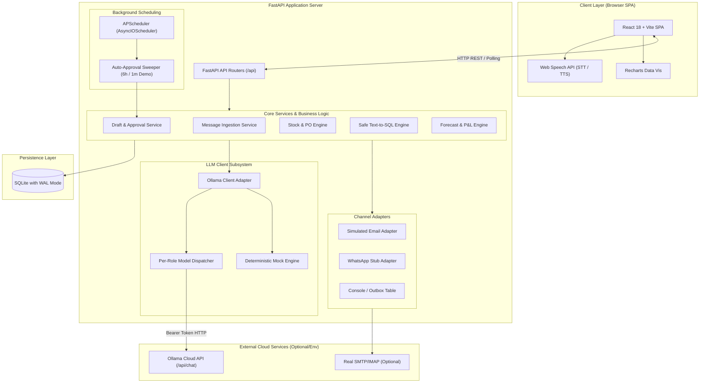
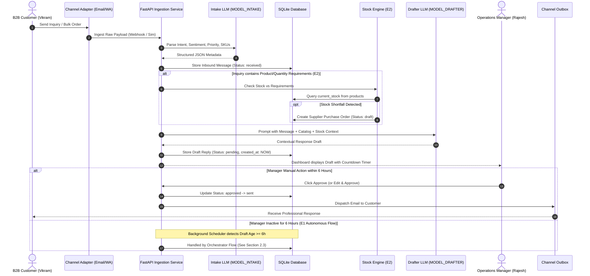
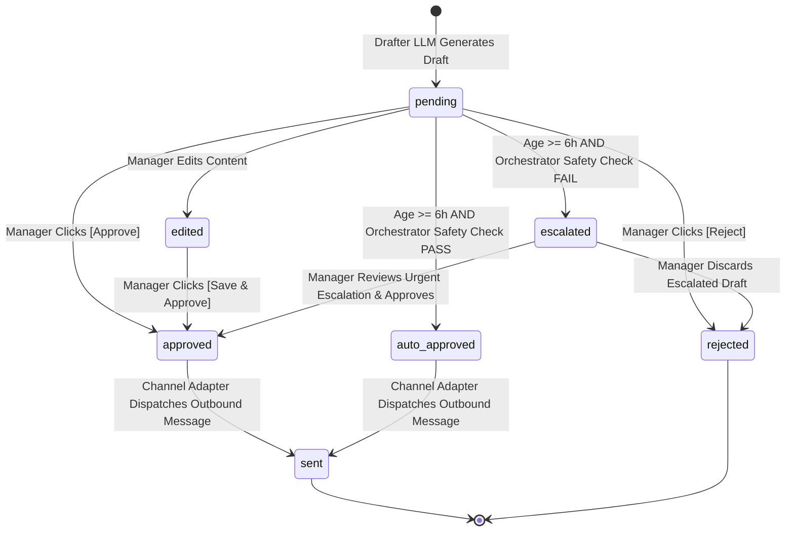
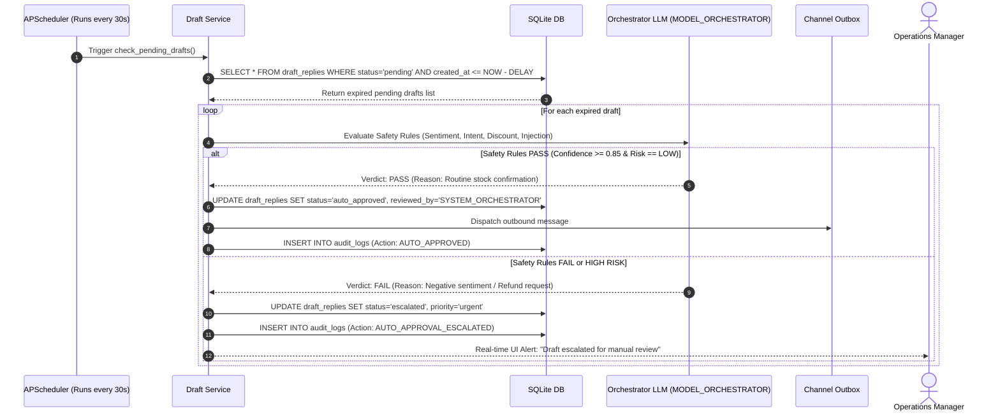

# System Architecture — OpsPilot AI

**Project:** OpsPilot AI (Trentar Pvt Ltd)  
**Document Version:** 1.0.0  
**Target:** Hackathon Reference Architecture  

---

## 1. System Overview & Component Diagram

OpsPilot AI is built as a lightweight, resilient, and demo-first monolith with clean internal module boundaries:
- **Client (Frontend):** Modern Single Page Application (SPA) built with React 18, Vite, TypeScript, Tailwind CSS, and Recharts. Communicates via REST and lightweight polling/SSE.
- **Application Server (Backend):** Python 3.11+ with FastAPI, utilizing asynchronous request handling and Pydantic v2 data validation.
- **Job Orchestrator:** Embedded `APScheduler` (AsyncIOScheduler) running in-process, querying persisted database state to ensure crash recovery.
- **Persistence Layer:** SQLite via SQLAlchemy Core & ORM, operating in WAL (Write-Ahead Logging) mode for concurrent reader/writer stability.
- **AI Core:** Unified Ollama Cloud Client wrapper supporting deterministic mock fallbacks, dynamic per-role model routing, JSON Schema enforcement, and structured output parsing.
- **Channel Layer:** Abstract Adapter pattern supporting simulated email, simulated WhatsApp, console outbox, and optional live SMTP/IMAP.



---

## 2. End-to-End Sequence & State Machine Diagrams

### 2.1 Inbound Message to Outbound Dispatch Lifecycle



---

### 2.2 Draft State Machine



---

### 2.3 Autonomous 6-Hour Auto-Approval Sequence (E1)



---

## 3. Technology Stack & Justifications

| Layer | Chosen Technology | One-Line Justification | Alternative Considered | Why Alternative Was Rejected |
| :--- | :--- | :--- | :--- | :--- |
| **Backend Framework** | **Python 3.11+ / FastAPI** | High-performance async support, native Pydantic validation, and clean Swagger/OpenAPI auto-docs. | Django / Flask | Django is too heavy with monolithic ORM overhead; Flask lacks native async and modern type validation. |
| **Database** | **SQLite (WAL Mode)** | Zero-install, file-based, zero configuration, 100% portable for local single-command hackathon demo. | PostgreSQL | Requires Docker/external daemon, adding setup friction, port conflicts, and failure modes on judges' laptops. |
| **Task Scheduler** | **APScheduler (AsyncIO)** | In-process asynchronous scheduler running alongside FastAPI without external brokers. | Celery + Redis | Introduces Redis server dependency and complex multi-process management prone to demo failure. |
| **Frontend Framework**| **React 18 + Vite (TS)** | Ultra-fast HMR, strict type-safety, robust ecosystem, and rapid UI prototyping. | Next.js / Vue | Next.js app-router adds unnecessary server-side rendering complexity; Vue has smaller ecosystem for rich data grids. |
| **Styling** | **Tailwind CSS** | Utility-first CSS allows immediate responsive styling and high-contrast dark/light mode for projectors. | CSS Modules / MUI | MUI is bloated with heavy bundle size; CSS Modules slow down rapid hackathon layout iterations. |
| **Voice Interface** | **Web Speech API** | Built directly into modern browsers (Chrome/Edge); requires zero API keys, zero latency, and supports Tamil/Hindi/English. | Whisper API + ElevenLabs | Adds paid external API keys, rate limits, credit exhaustion, and network round-trip audio latency. |
| **Data Visualization**| **Recharts** | Declarative, SVG-based React charts that animate smoothly and respond to dynamic window resizing. | Chart.js | Chart.js requires imperative canvas refs and tricky React wrapper lifecycle management. |

---

## 4. Folder & Module Structure

```
Titan-Devs/
├── docs/                               # Architecture and Planning Documentation
│   ├── 01_PRD.md
│   ├── 02_ARCHITECTURE.md
│   ├── 03_DATA_MODEL.md
│   ├── 04_API_AND_AGENTS.md
│   ├── 05_UI_UX.md
│   ├── 06_RISK_AND_SECURITY.md
│   ├── 07_EXECUTION_PLAN.md
│   └── 08_DEMO_STRATEGY.md
│
├── backend/                            # FastAPI Application
│   ├── app/
│   │   ├── __init__.py
│   │   ├── main.py                     # App entry point, CORS, lifecycle, scheduler setup
│   │   ├── config.py                   # Pydantic Settings (.env loader)
│   │   │
│   │   ├── core/                       # Cross-cutting concerns
│   │   │   ├── database.py             # SQLite engine, sessionmaker, WAL configuration
│   │   │   ├── scheduler.py            # APScheduler instance & recurring jobs
│   │   │   ├── security.py             # Sanitization, SQL AST validator, prompt filters
│   │   │   └── exceptions.py           # Custom application exceptions & handlers
│   │   │
│   │   ├── models/                     # SQLAlchemy ORM Models
│   │   │   ├── base.py
│   │   │   ├── customer.py             # Customer entity
│   │   │   ├── product.py              # Product and inventory entity
│   │   │   ├── supplier.py             # Supplier and PO entity
│   │   │   ├── message.py              # Inbound message & draft replies
│   │   │   ├── sales.py                # Sales history for forecasting
│   │   │   └── audit.py                # System and manager audit log
│   │   │
│   │   ├── schemas/                    # Pydantic Request/Response DTOs
│   │   │   ├── message_dto.py
│   │   │   ├── draft_dto.py
│   │   │   ├── stock_dto.py
│   │   │   ├── assistant_dto.py
│   │   │   └── analytics_dto.py
│   │   │
│   │   ├── agents/                     # LLM Agent Implementations
│   │   │   ├── base_agent.py           # Abstract agent with retry & schema enforcement
│   │   │   ├── intake_agent.py         # Classifier & Entity Extractor (MODEL_INTAKE)
│   │   │   ├── drafter_agent.py        # Reply Draft Generator (MODEL_DRAFTER)
│   │   │   ├── orchestrator_agent.py   # Safety & Auto-Approval Evaluator (MODEL_ORCHESTRATOR)
│   │   │   ├── sql_agent.py            # Safe Read-Only SQL Generator (MODEL_SQL)
│   │   │   └── insights_agent.py       # P&L and Inventory Forecaster (MODEL_INSIGHTS)
│   │   │
│   │   ├── llm/                        # LLM Infrastructure Layer
│   │   │   ├── client.py               # Unified Ollama Cloud client (httpx async)
│   │   │   └── mock_llm.py             # High-fidelity deterministic mock responses
│   │   │
│   │   ├── adapters/                   # Channel Adapters
│   │   │   ├── base.py                 # ChannelAdapter Abstract Base Class
│   │   │   ├── simulated_email.py      # In-memory & DB simulated inbox/outbox
│   │   │   ├── whatsapp_stub.py        # WhatsApp webhook/outbox emulator
│   │   │   └── smtp_adapter.py         # Optional real SMTP/IMAP driver
│   │   │
│   │   ├── services/                   # Business Logic Domain Services
│   │   │   ├── message_service.py
│   │   │   ├── stock_service.py
│   │   │   ├── auto_approval_service.py
│   │   │   ├── sql_service.py
│   │   │   └── forecast_service.py
│   │   │
│   │   ├── api/                        # REST API Endpoints
│   │   │   ├── v1/
│   │   │   │   ├── messages.py         # Ingestion, list, details
│   │   │   │   ├── drafts.py           # Approve, edit, reject
│   │   │   │   ├── stock.py            # Inventory, PO list & approval
│   │   │   │   ├── assistant.py        # Safe Text-to-SQL & voice endpoint
│   │   │   │   ├── analytics.py        # Forecast, P&L, AI summary
│   │   │   │   └── settings.py         # Demo overrides, mock toggles
│   │   │   └── deps.py                 # FastAPI dependency injection (DB sessions)
│   │   │
│   │   └── seeds/                      # Seed Data Generator
│   │       ├── seed_data.py            # Products, suppliers, sales history generator
│   │       └── sample_messages.py      # 15 realistic multilingual demo messages
│   │
│   ├── requirements.txt
│   └── .env.example
│
├── frontend/                           # React + Vite Application
│   ├── src/
│   │   ├── assets/
│   │   ├── components/                 # Reusable UI Components
│   │   │   ├── layout/                 # TopNav, Sidebar, ImpactScorecard, ProjectorBanner
│   │   │   ├── common/                 # Button, Badge, Modal, CountdownTimer, Toast
│   │   │   ├── inbox/                  # MessageList, MessageDetail, DraftReviewCard
│   │   │   ├── stock/                  # ShortfallCard, SupplierPOModal, InventoryTable
│   │   │   ├── assistant/              # VoiceInputButton, SQLDrawer, QueryResultsTable
│   │   │   └── analytics/              # ForecastChart, PnLCard, AIInsightsWidget
│   │   │
│   │   ├── pages/                      # Page Views
│   │   │   ├── InboxPage.tsx           # Split-screen Manager Inbox & Approvals
│   │   │   ├── StockOrdersPage.tsx     # Supplier PO management & stock alerts
│   │   │   ├── AssistantPage.tsx       # Multilingual Text & Voice Ask Trentar AI
│   │   │   ├── AnalyticsPage.tsx       # Forecast, P&L, and Executive Summary
│   │   │   ├── AuditLogPage.tsx        # Human vs AI action timeline
│   │   │   └── SettingsPage.tsx        # Live/Mock toggle, demo timer slider
│   │   │
│   │   ├── hooks/                      # Custom React Hooks
│   │   │   ├── useSpeechRecognition.ts # Web Speech API STT Hook (En, Ta, Hi)
│   │   │   ├── useSpeechSynthesis.ts   # Web Speech API TTS Hook
│   │   │   └── useCountdown.ts         # Draft deadline countdown timer hook
│   │   │
│   │   ├── services/                   # Frontend API Client
│   │   │   └── api.ts                  # Axios / Fetch client with TypeScript types
│   │   │
│   │   ├── types/                      # TypeScript Interface Definitions
│   │   │   └── index.ts
│   │   │
│   │   ├── App.tsx
│   │   ├── main.tsx
│   │   └── index.css                   # Tailwind base imports and theme variables
│   │
│   ├── package.json
│   ├── tsconfig.json
│   ├── vite.config.ts
│   └── tailwind.config.js
│
└── run_demo.bat / run_demo.sh          # Single command demo bootstrapper
```

---

## 5. LLM Client Architecture & Resilience Strategy

The system interfaces with Ollama Cloud API (`https://ollama.com/api/chat` or private hosted gateway) using standard HTTP POST requests with Bearer authentication.

### 5.1 Per-Role Model Configuration
The application separates tasks across specific model configurations defined in `.env`:
- `MODEL_INTAKE`: Lightweight, fast classification model (e.g. `llama3.2:3b`, `qwen2.5:7b`).
- `MODEL_DRAFTER`: Nuanced language generation model (e.g. `llama3.3:70b`, `mistral-small`).
- `MODEL_ORCHESTRATOR`: High-reasoning safety & compliance model (e.g. `llama3.3:70b`, `qwen2.5:32b`).
- `MODEL_SQL`: Code and SQL specialized model (e.g. `qwen2.5-coder:7b`, `codellama`).
- `MODEL_INSIGHTS`: Analytical synthesis model (e.g. `llama3.3:70b`).

### 5.2 Client Wrapper Capabilities
1. **JSON Enforcement:** Utilizes Ollama's `format: "json"` alongside Pydantic schema validation. If the output fails validation, the client retries once with explicit error feedback in the prompt.
2. **Timeout & Retries:** Strict 15-second HTTP timeout with exponential backoff (2 attempts max). If requests timeout or fail, it seamlessly drops into Fallback/Mock mode without crashing the UI.
3. **Deterministic Mock LLM Mode (`USE_MOCK_LLM=true`):**
   - Matches incoming message keywords, language tags, and SKUs against predefined deterministic responses.
   - Generates instantaneous, 100% predictable responses for zero-network environments.
   - Essential for rapid frontend development and offline backup during hackathon judging.

```python
# Conceptual LLM Client Wrapper Design
class OllamaClient:
    def __init__(self, api_key: str, base_url: str, use_mock: bool):
        self.api_key = api_key
        self.base_url = base_url
        self.use_mock = use_mock
        self.http_client = httpx.AsyncClient(timeout=15.0)

    async def generate_structured(
        self, 
        role_model: str, 
        system_prompt: str, 
        user_prompt: str, 
        response_schema: Type[BaseModel]
    ) -> BaseModel:
        if self.use_mock:
            return MockLLMRegistry.resolve(role_model, user_prompt, response_schema)
        
        headers = {"Authorization": f"Bearer {self.api_key}", "Content-Type": "application/json"}
        payload = {
            "model": role_model,
            "messages": [
                {"role": "system", "content": system_prompt},
                {"role": "user", "content": user_prompt}
            ],
            "stream": False,
            "format": "json"
        }
        
        for attempt in range(2):
            try:
                res = await self.http_client.post(f"{self.base_url}/api/chat", json=payload, headers=headers)
                res.raise_for_status()
                content = res.json()["message"]["content"]
                return response_schema.model_validate_json(content)
            except Exception as e:
                if attempt == 1:
                    # Graceful degradation to mock if live API breaks
                    logger.warning(f"Ollama call failed ({e}); falling back to deterministic mock.")
                    return MockLLMRegistry.resolve(role_model, user_prompt, response_schema)
                await asyncio.sleep(1.0)
```

---

## 6. Channel Adapter Design

To support multiple intake channels (Email, WhatsApp, Procurement Portals) without polluting business logic, all ingress/egress is decoupled through a unified `ChannelAdapter` interface.

```python
class ChannelAdapter(ABC):
    @abstractmethod
    async def poll_inbound(self) -> List[InboundMessageDTO]:
        """Poll or receive inbound messages."""
        pass

    @abstractmethod
    async def send_outbound(self, recipient: str, subject: str, content: str, reply_to_id: str) -> bool:
        """Dispatch outbound response to customer or supplier."""
        pass
```

1. **SimulatedEmailAdapter:** Maintains a database table `simulated_mailbox` where test emails are seeded. When an outbound draft is sent, it writes to `simulated_outbox` so judges can see the outgoing email exactly as delivered.
2. **WhatsAppStubAdapter:** Formats messages with WhatsApp-style markdown (`*bold*`, emojis) and logs to simulated chat threads.
3. **Optional SmtpImapAdapter:** Can be enabled by setting `SMTP_HOST`, `IMAP_HOST`, `EMAIL_USER`, `EMAIL_PASS` in `.env`.

---

## 7. Crash-Resilient 6-Hour Scheduler Architecture

### Problem
In a hackathon or production server, if the application server restarts, memory-based timers (like `asyncio.sleep(21600)` or in-memory job queues) lose their state, causing drafts to never auto-approve or to double-approve.

### Solution: Database-Driven State Sweeper
1. When a draft is created, it is inserted into `draft_replies` with:
   - `status = 'pending'`
   - `created_at = CURRENT_TIMESTAMP`
   - `auto_approve_deadline = CURRENT_TIMESTAMP + INTERVAL (e.g. 6 hours)`
2. An `APScheduler` job runs every 30 seconds:
   ```sql
   SELECT id, inbound_message_id, draft_text 
   FROM draft_replies 
   WHERE status = 'pending' 
     AND auto_approve_deadline <= CURRENT_TIMESTAMP;
   ```
3. **Survives Restarts:** Even if the server crashes for 2 hours, the moment it reboots, the sweeper picks up all drafts that expired during downtime and processes them immediately through the Orchestrator LLM.
4. **Demo Override:** The `AUTO_APPROVE_DELAY_MINUTES` setting can be toggled via API/UI to `1` (60 seconds). Deadlines are calculated relative to `created_at`, so judges can watch a draft count down from 60s to 0s and trigger live auto-approval.
