# Phased Execution Plan & Timeline — OpsPilot AI

**Project:** OpsPilot AI (Trentar Pvt Ltd)  
**Assumed Time Budget:** 24 Hours Total Build Time  
**Execution Methodology:** Incremental, Test-Driven Slices with Guaranteed Fallback Baseline  
**Document Version:** 1.0.0  

---

## 1. 24-Hour Phased Build Plan

```mermaid
gantt
    title 24-Hour Hackathon Execution Timeline
    dateFormat  HH:mm
    axisFormat  %H:%M
    
    section Phase 1: Foundation
    Scaffolding & DB Models & Seed Data (M)        :p1_1, 00:00, 2h
    LLM Client Wrapper & Deterministic Mock (M)   :p1_2, after p1_1, 1.5h
    
    section Phase 2: Core Flow
    Ingestion Pipeline & Classifier Agent (M)     :p2_1, after p1_2, 2h
    Drafter Agent & Channel Outbox (M)            :p2_2, after p2_1, 2h
    Manager Split-Screen Inbox UI (L)             :p2_3, after p2_2, 3h
    
    section Phase 3: E1 Auto-Approve
    APScheduler Engine & 1m Demo Override (M)     :p3_1, after p2_3, 2h
    Orchestrator Safety Agent & UI Countdown (M)  :p3_2, after p3_1, 1.5h
    
    section Phase 4: E2 Stock Check
    Shortfall Computation & PO Generator (M)      :p4_1, after p3_2, 2h
    Supplier PO UI & Approval Modal (M)           :p4_2, after p4_1, 1.5h
    
    section Phase 5: E3 SQL Assistant
    Read-Only SQL AST Sandbox & Whitelist (M)     :p5_1, after p4_2, 2h
    Multilingual Web Speech Audio UI (M)          :p5_2, after p5_1, 1.5h
    
    section Phase 6: E4 Forecasting
    30-Day Demand & P&L Formula Engine (S)        :p6_1, after p5_2, 1h
    Recharts Dashboard & Insights Agent (M)       :p6_2, after p6_1, 1h
    
    section Phase 7: Polish & Demo
    Single-Command Launcher & Rehearsal (S)       :p7_1, after p6_2, 1h
```

---

## 2. Phase-by-Phase Task Checklist & Definition of Done

### Phase 1: Foundation, DB, Seed Data & LLM Client (Hours 00:00 - 03:30)
- [x] **Task 1.1 [Size: M] [Backend]:** Initialize FastAPI project, config via Pydantic Settings, SQLite with WAL mode.
- [x] **Task 1.2 [Size: M] [Backend]:** Define SQLAlchemy models (`customers`, `products`, `suppliers`, `inbound_messages`, `draft_replies`, `stock_orders`, `sales_history`, `audit_logs`).
- [x] **Task 1.3 [Size: M] [Data]:** Build `seed_data.py` with 30 Trentar products, 5 suppliers, 40 customers, 12 months sales history, and 15 multilingual test messages.
- [x] **Task 1.4 [Size: M] [Backend/AI]:** Implement `OllamaClient` with retry logic, structured JSON parsing, and full `MockLLMRegistry` containing deterministic responses for all 15 test messages.
- **Definition of Done (DoD):** Running `pytest` verifies database migrations, seed data loads without foreign key errors, and mock LLM returns structured JSON schemas for all 5 agent roles. [VERIFIED & PASSED]

---

### Phase 2: Core Flow — Ingestion, Classification & Review Dashboard (Hours 03:30 - 10:30)
- [x] **Task 2.1 [Size: M] [Backend]:** Create `POST /api/v1/messages/webhook` and `POST /api/v1/messages/simulate-batch`.
- [x] **Task 2.2 [Size: M] [Backend/AI]:** Implement `IntakeAgent` (`MODEL_INTAKE`) and `DrafterAgent` (`MODEL_DRAFTER`).
- [x] **Task 2.3 [Size: S] [Backend]:** Implement `SimulatedEmailAdapter` and `outbox_messages` table logger.
- [x] **Task 2.4 [Size: L] [Frontend]:** Scaffold React + Vite + Tailwind project; build TopNav, Sidebar, and Split-Screen `/inbox` view.
- [x] **Task 2.5 [Size: M] [Frontend]:** Connect `Approve`, `Edit`, and `Reject` buttons with optimistic UI updates.
- **Definition of Done (DoD):** Triggering an inbound test email appears in the manager inbox; clicking "Approve" transitions draft to `sent` and logs record into the outbox table. [VERIFIED & PASSED]

---

### Phase 3: Extra 1 (E1) — 6-Hour Auto-Approval & Safety Orchestrator (Hours 10:30 - 14:00)
- [ ] **Task 3.1 [Size: M] [Backend]:** Configure `APScheduler` async job running every 30 seconds to query expired pending drafts.
- [ ] **Task 3.2 [Size: S] [Backend]:** Add dynamic `AUTO_APPROVE_DELAY_MINUTES` setting (default 360, togglable to 1 for demo).
- [ ] **Task 3.3 [Size: M] [Backend/AI]:** Implement `OrchestratorAgent` (`MODEL_ORCHESTRATOR`) with safety rules and automatic escalation flags.
- [ ] **Task 3.4 [Size: M] [Frontend]:** Implement `CountdownTimer.tsx` with color transitions (blue -> amber -> red) and auto-refresh on zero.
- **Definition of Done (DoD):** Setting the delay to 1 minute causes an unreviewed routine draft to auto-dispatch at 00:00, while a negative complaint draft escalates with an urgent badge.

---

### Phase 4: Extra 2 (E2) — Stock Shortfall & Supplier PO Generation (Hours 14:00 - 17:30)
- [ ] **Task 4.1 [Size: M] [Backend]:** Integrate stock-check logic into ingestion: compute `shortfall = requested_qty - in_hand + buffer`.
- [ ] **Task 4.2 [Size: M] [Backend]:** Create `stock_orders` and `stock_order_items` records mapped to verified suppliers.
- [ ] **Task 4.3 [Size: M] [Frontend]:** Build `/stock-orders` page with supplier PO cards, cost breakdowns, and approval modal.
- [ ] **Task 4.4 [Size: S] [Frontend]:** Cross-link originating customer message in Inbox with the generated Supplier PO.
- **Definition of Done (DoD):** Ingesting message M02 (Deccan Drones requesting 25 motors when only 8 are in stock) automatically generates PO-2026-0042 for Kavach Drives, ready for manager approval.

---

### Phase 5: Extra 3 (E3) — Safe Text-to-SQL Multilingual Voice Assistant (Hours 17:30 - 21:00)
- [ ] **Task 5.1 [Size: M] [Backend]:** Setup read-only SQLite URI (`file:trentar.db?mode=ro`) and `sqlglot` AST validator (SELECT only, table whitelist, LIMIT 50).
- [ ] **Task 5.2 [Size: M] [Backend/AI]:** Implement `SQLAgent` (`MODEL_SQL`) supporting English, Tamil, and Hindi system prompts.
- [ ] **Task 5.3 [Size: M] [Frontend]:** Build `/assistant` view with text prompt, executed SQL drawer, and results table.
- [ ] **Task 5.4 [Size: M] [Frontend]:** Integrate browser native Web Speech API for Tamil (`ta-IN`), Hindi (`hi-IN`), and English (`en-IN`) STT and TTS.
- **Definition of Done (DoD):** Asking in Tamil *"கடந்த 3 மாதங்களில் அதிக விற்பனையான பொருள் எது?"* produces valid SQL, displays the top-selling motor in a table, and reads aloud the Tamil answer.

---

### Phase 6: Extra 4 (E4) — Predictive Demand & P&L Insights (Hours 21:00 - 23:00)
- [ ] **Task 6.1 [Size: S] [Backend]:** Implement 30-day weighted moving average and stockout risk formulas on `sales_history`.
- [ ] **Task 6.2 [Size: M] [Backend/AI]:** Implement `InsightsAgent` (`MODEL_INSIGHTS`) to produce executive markdown briefings.
- [ ] **Task 6.3 [Size: M] [Frontend]:** Build `/analytics` page with Recharts demand curves, stockout risk badges, and financial metrics.
- **Definition of Done (DoD):** Page displays interactive demand charts and an AI-generated briefing highlighting impending motor and battery stockouts.

---

### Phase 7: Polish, README, Launcher & Rehearsal (Hours 23:00 - 24:00)
- [ ] **Task 7.1 [Size: S] [DevOps]:** Create `run_demo.bat` and `run_demo.sh` single-command launchers.
- [ ] **Task 7.2 [Size: S] [Docs]:** Write clean `README.md` with architecture summary, quickstart, and demo script.
- [ ] **Task 7.3 [Size: S] [QA]:** Complete end-to-end rehearsal with mock mode and live model fallback.
- **Definition of Done (DoD):** Fresh terminal clone launches app with one command; full 4-minute demo runs flawlessly.

---

## 3. Timeline & Strategic "Cut Line"

| Hour Marker | Target Milestone | Status / Risk Evaluation |
| :--- | :--- | :--- |
| **Hour 03:30** | Database & Mock LLM Baseline Complete | **MANDATORY GATE:** If delayed, stop everything and fix DB/Mock. |
| **Hour 10:30** | Core Ingestion & Manager Inbox Functional | **MANDATORY GATE:** Core must be solid before touching extras. |
| **Hour 14:00** | E1: 6-Hour Auto-Approval Complete | **PRIMARY EXTRA GATE:** Key differentiator for PS#601 speed. |
| **Hour 17:30** | E2: Stock Check & Supplier PO Complete | **SECONDARY EXTRA GATE:** Completes operational automation loop. |
| **Hour 21:00** | E3: Safe Text-to-SQL & Voice Complete | **OPTIONAL EXTRA GATE:** High visual impact for judges. |
| **Hour 23:00** | E4: Predictive Analytics Complete | **STRETCH GOAL:** Nice to have. |
| **Hour 24:00** | Polish, Single-Command Runner, Rehearsal | **DEMO FREEZE:** Zero new code; test and rehearse only. |

### The Strategic Cut Line Hierarchy
If time runs short or unexpected bugs arise, features are shed in this exact order to protect the winning core:
1. **CUT 1: E4 Predictive Analytics & P&L** (Drop the Recharts forecast page; replace with static pre-computed stats).
2. **CUT 2: E3 Voice Synthesis / Audio** (Drop TTS read-aloud; retain text-based SQL querying).
3. **CUT 3: E3 Text-to-SQL Assistant** (Drop employee assistant entirely; focus 100% on Manager Operations).
4. **NEVER CUT:** **Core Ingestion + E1 Auto-Approval + E2 Stock Reorders.** This trio completely satisfies PS#601.

---

## 4. Frontend vs. Backend Parallelization Matrix

Once Phase 1 establishes the Pydantic schemas and mock responses, two engineers or agents can work concurrently without blocking:

| Stage | Backend Developer / Agent | Frontend Developer / Agent | Integration Contract |
| :--- | :--- | :--- | :--- |
| **Phase 2** | Builds `/api/v1/messages` endpoints, SQLite persistence, and `IntakeAgent`. | Builds Manager Inbox layout, message cards, and draft editor using static Mock JSON. | `MessageDTO` & `DraftReplyDTO` schemas |
| **Phase 3** | Builds `APScheduler` sweeper and `OrchestratorAgent` safety evaluator. | Implements `CountdownTimer.tsx`, status transition animations, and settings modal. | `auto_approve_deadline` timestamp & `/settings` |
| **Phase 4** | Builds shortfall calculator and `stock_orders` relational generator. | Builds `/stock-orders` page, PO summary cards, and supplier approval dialog. | `StockOrderDTO` & `/stock-orders` API |
| **Phase 5** | Implements read-only SQLite URI and `sqlglot` AST query engine. | Implements Voice microphone button, language selector, and results table. | `/assistant/query` POST endpoint contract |

---

## 5. Comprehensive Test & Demo Rehearsal Plan

1. **Pre-Flight Sanity (Hour 23:00):**
   - Run backend tests: `pytest backend/tests` (verifying AST validator, prompt injection catch, shortfall formula).
   - Verify frontend build: `npm run build` (zero TypeScript errors).
2. **Zero-Network Air-Gap Test (Hour 23:20):**
   - Disconnect Wi-Fi. Set `USE_MOCK_LLM=true`.
   - Run full 5-minute demo walkthrough. Ensure all 15 scenarios function instantaneously without internet.
3. **Projector Contrast & Audio Check (Hour 23:40):**
   - View UI at 125% browser zoom. Confirm text, countdowns, and table borders are legible from 20 feet away.
   - Test laptop speaker volume for Tamil and Hindi Web Speech output.

---

## 6. Plan Changes After Self-Review

Following architectural review, the following three structural enhancements were made to reduce risk and prevent scope bloat:
1. **Simplified E4 Demand Algorithm:** Replaced heavy external ML dependencies (Prophet, statsmodels, scikit-learn) with a robust weighted moving average (WMA) implemented in pure Python. This eliminated 250MB of Python package bloat and guaranteed zero runtime installation failures.
2. **Crash-Proof Database Sweeper for E1:** Abandoned in-memory Python timers (`asyncio.sleep`) in favor of a persistent timestamp query (`auto_approve_deadline <= NOW()`) executed by APScheduler. This guarantees that server restarts or crashes will never drop pending approvals.
3. **Air-Gap Voice Fallback for E3:** Added pre-set query buttons to the Ask Trentar AI UI. If the hackathon hall has microphone background noise or audio permissions fail, the presenter can click the query buttons to execute the exact same multilingual SQL flow seamlessly.

